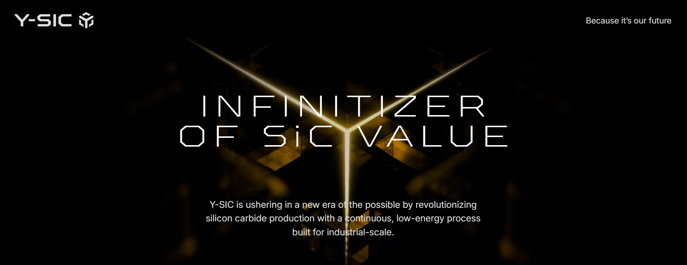

  

  <h3>Because it's our future.</h3>
  <h1>Infinitizer of SiC Value</h1>

  

    Y-SIC is ushering in a new era of the possible by
    revolutionizing silicon carbide production with a
    continuous, low-energy process built for industrial-scale.
  

---

## What We Do

**What is possible at the end is decided at its start.**

Silicon carbide is the material the power electronics of the coming years will be built from.

Crystal growth, wafer quality and device yield all carry the properties of the powder upstream.

Y-SIC set out to rebuild the first step of silicon carbide production.

## The Y-SIC Process

A novel, continuous manufacturing process for high-purity silicon carbide.

### Advantages

- 80% less energy consumption
- Continuous manufacturing process
- High purity SiC material
- Wide range of particle sizes
- Tailored material properties, including custom doping, sintering, 3C/6H
- Scalable for high-volume production
- Made in Germany

### Applications

**Power Electronics · Interposer · AR Glasses**

## Working Together

**Samples**

We supply material in the quantity you need for incoming inspection, with a full certificate of analysis.

**Qualification**

We support your approval process and provide the evidence your quality assurance requires.

**Joint Development**

If your application needs a specification that does not exist yet, we develop it with you: grain size, distribution and chemical composition.

## Y-SIC Today

**3 Sites · >50 Employees · One Vision**

- **Berlin** — Material and process development
- **Osnabrück** — Current production
- **Dillingen/Saar** — Industrial-scale production plant in development

### Quality & Innovation

- **Certification:** Various certifications, including ISO 9001, are in progress.
- **Quality Assurance:** A certificate of analysis documents the quality of every delivery.
- **Patented Process:** More than 20 patents, granted and pending, protect our production process.
- **European Supply Chain:** Short routes and reduced dependencies in material supply.

## Careers

We are growing our teams in production, quality assurance and development.

We offer the opportunity to work on a unique production process in a small, international team.

---

  <h3>Because it's our future.</h3>
  
© 2026 The Yellow SiC Holding GmbH

